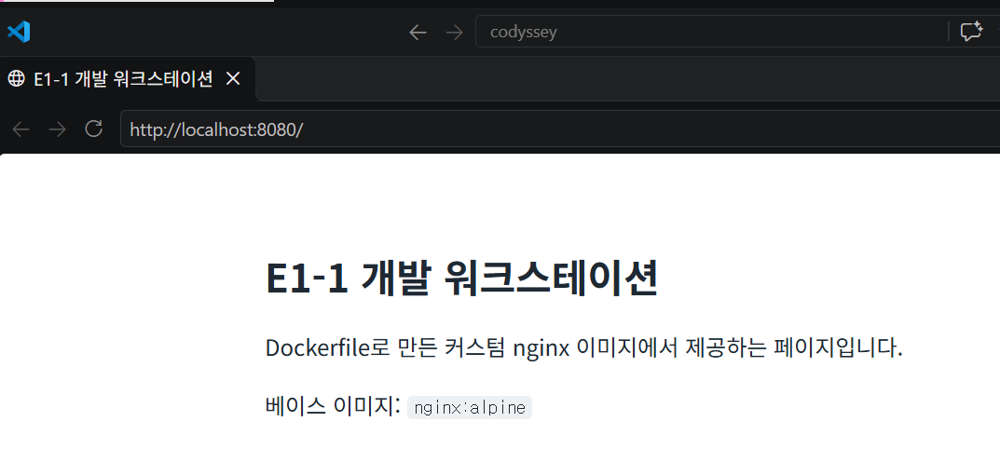
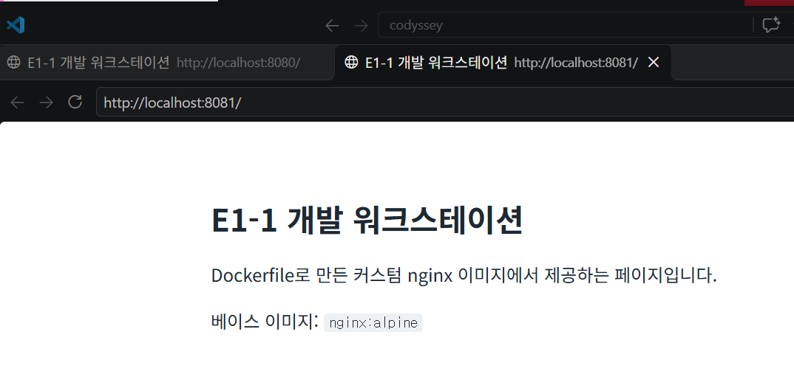

# E1-1 개발 워크스테이션 구축

코디세이(Codyssey) 입학연수 미션 01 제출 저장소입니다. 미션 원문은 [docs/mission.md](docs/mission.md)에 있습니다.

## 1. 프로젝트 개요

터미널, Docker, Git/GitHub를 직접 세팅해서 누구나 같은 방식으로 실행할 수 있는 개발 환경을 구성합니다. 웹 서버를 Dockerfile로 컨테이너화하고, 포트 매핑과 바인드 마운트, 볼륨의 동작을 실행 결과로 검증합니다.

## 2. 실행 환경

| 항목 | 값 |
| --- | --- |
| OS | Windows 10 Pro (10.0.19045) |
| Shell | GNU bash 5.2.37 (Git Bash) |
| 터미널 | VS Code, Git Bash |
| Docker | 29.5.2 (Docker Desktop 4.75.0, WSL2 백엔드) |
| Git | 2.50.1.windows.1 |

## 3. 수행 체크리스트

- [x] 터미널 기본 조작 및 폴더 구성
- [x] 권한 변경 실습 (파일 1개, 디렉토리 1개)
- [x] Docker 설치/점검 (`docker --version`, `docker info`)
- [x] Docker 기본 운영 명령 (images, ps, logs, stats)
- [x] hello-world 실행
- [x] ubuntu 컨테이너 진입 및 attach/exec 차이 정리
- [x] Dockerfile 커스텀 이미지 빌드/실행
- [x] 포트 매핑 접속 (브라우저 화면 첨부)
- [ ] 바인드 마운트 반영 (변경 전/후 비교)
- [ ] Docker 볼륨 영속성 (컨테이너 삭제 전/후 비교)
- [ ] Git 설정 (`git config --list`)
- [ ] VSCode GitHub 연동 및 저장소 공개
- [x] 트러블슈팅 2건 이상 정리
- [ ] 보너스 과제 (선택)

## 4. 검증 방법

| 항목 | 확인 명령 | 확인한 내용 | 결과 위치 |
| --- | --- | --- | --- |
| 터미널 조작 | `pwd`, `ls -la`, `cat`, `wc -c` | 생성, 복사, 이동, 이름변경, 삭제 후 파일 상태 | [5.1](#51-터미널-기본-조작), [전체 로그](docs/logs/01-terminal.log) |
| 권한 변경 | `stat -c "%a %A %U %n"`, `su ubuntu -c ...` | 변경 전/후 권한 값과 일반 사용자의 접근 허용/거부 | [5.2](#52-권한-변경-실습), [전체 로그](docs/logs/02-permission.log) |
| Docker 점검 | `docker --version`, `docker info` | 클라이언트 버전과 데몬 응답 | [5.3](#53-docker-설치점검), [전체 로그](docs/logs/03-docker-check.log) |
| Docker 운영 | `docker images`, `docker ps`, `docker ps -a`, `docker logs`, `docker stats` | 이미지 다운로드, 컨테이너 실행/중지/삭제 상태, 로그, 리소스 사용량 | [5.4](#54-docker-기본-운영-명령), [전체 로그](docs/logs/04-docker-ops.log) |
| hello-world | `docker run hello-world`, `docker ps -a` | `Hello from Docker!` 출력과 `Exited (0)` 종료 상태 | [5.5](#55-hello-world-실행), [전체 로그](docs/logs/05-hello-world.log) |
| ubuntu 진입 | `docker exec`, `docker attach`, `docker ps -a` | 내부 명령 출력과 exec/attach 후 컨테이너 상태 차이 | [5.6](#56-ubuntu-컨테이너-진입과-attachexec-비교), [전체 로그](docs/logs/06-ubuntu-attach-exec.log) |
| 커스텀 이미지 | `docker build`, `docker ps`, `wget -S` | 빌드 성공, `healthy` 상태, 페이지 응답과 `X-App-Env` 헤더 | [5.7](#57-dockerfile-커스텀-이미지), [전체 로그](docs/logs/07-custom-image.log) |
| 포트 매핑 | `docker port`, `curl`, 브라우저, `docker logs` | 매핑 전 접속 실패, 8080/8081 접속 성공, 브라우저 요청 기록 | [5.8](#58-포트-매핑-접속), [전체 로그](docs/logs/08-port-mapping.log) |

## 5. 수행 로그

### 5.1 터미널 기본 조작

Git Bash에서 `practice/terminal` 폴더를 만들어 실습했습니다. 저장소 경로는 PC마다 다르므로, 재현할 때는 저장소 루트에서 시작하고 절대 경로 부분만 본인 경로로 바꾸면 됩니다. 아래는 발췌이고, 전체 출력은 [docs/logs/01-terminal.log](docs/logs/01-terminal.log)에 있습니다.

**현재 위치 확인, 폴더 생성, 이동**

```console
$ pwd
/c/Users/yeonseo/codyssey/E1-1

$ mkdir -p practice/terminal

$ cd practice/terminal

$ pwd
/c/Users/yeonseo/codyssey/E1-1/practice/terminal
```

**빈 파일 생성, 파일 내용 확인**

```console
$ touch empty.txt

$ echo "hello codyssey" > notes.txt

$ ls -la
total 1
drwxr-xr-x 1 yeonseo 197121  0 Nov  6 01:06 .
drwxr-xr-x 1 yeonseo 197121  0 Nov  6 01:06 ..
-rw-r--r-- 1 yeonseo 197121  0 Nov  6 01:06 empty.txt
-rw-r--r-- 1 yeonseo 197121 15 Nov  6 01:06 notes.txt

$ cat notes.txt
hello codyssey

$ wc -c empty.txt notes.txt
 0 empty.txt
15 notes.txt
15 total
```

**복사, 이동, 이름변경**

```console
$ cp notes.txt notes_copy.txt

$ mkdir backup

$ cp -r backup backup_copy

$ mv notes_copy.txt backup/

$ mv backup/notes_copy.txt backup/renamed.txt

$ ls -la backup
total 5
drwxr-xr-x 1 yeonseo 197121  0 Nov  6 01:06 .
drwxr-xr-x 1 yeonseo 197121  0 Nov  6 01:06 ..
-rw-r--r-- 1 yeonseo 197121 15 Nov  6 01:06 renamed.txt

$ cat backup/renamed.txt
hello codyssey
```

**삭제**

```console
$ rm empty.txt

$ rm -r backup_copy

$ ls -la
total 5
drwxr-xr-x 1 yeonseo 197121  0 Nov  6 01:06 .
drwxr-xr-x 1 yeonseo 197121  0 Nov  6 01:06 ..
drwxr-xr-x 1 yeonseo 197121  0 Nov  6 01:06 backup
-rw-r--r-- 1 yeonseo 197121 15 Nov  6 01:06 notes.txt
```

**숨김 파일 확인**

이름이 `.`으로 시작하는 파일은 `ls`에 나오지 않고 `-a` 옵션을 붙여야 보입니다.

```console
$ touch .hidden

$ ls
backup
notes.txt

$ ls -a
.
..
.hidden
backup
notes.txt

$ rm .hidden
```

**절대 경로와 상대 경로**

절대 경로는 루트(`/`)부터 적기 때문에 어디서 실행해도 같은 위치를 가리킵니다. 상대 경로는 현재 위치가 기준이라서, 같은 `../practice/terminal`도 현재 위치에 따라 다른 곳을 가리킵니다.

```console
$ cd /c/Users/yeonseo/codyssey/E1-1/docs

$ pwd
/c/Users/yeonseo/codyssey/E1-1/docs

$ cd ../practice/terminal

$ pwd
/c/Users/yeonseo/codyssey/E1-1/practice/terminal
```

### 5.2 권한 변경 실습

`ls -l`의 첫 글자는 종류(`-` 파일, `d` 디렉토리)이고, 나머지 9글자는 소유자, 그룹, 기타 사용자의 권한을 3글자씩 나타냅니다. 숫자 표기는 자리마다 r=4, w=2, x=1을 더한 값입니다.

| 표기 | 소유자 | 그룹 | 기타 | 의미 |
| --- | --- | --- | --- | --- |
| `644` | `rw-` (6) | `r--` (4) | `r--` (4) | 소유자만 수정, 나머지는 읽기 |
| `755` | `rwx` (7) | `r-x` (5) | `r-x` (5) | 소유자만 수정, 나머지는 읽기와 실행 |
| `600` | `rw-` (6) | `---` (0) | `---` (0) | 소유자만 읽기와 쓰기 |
| `700` | `rwx` (7) | `---` (0) | `---` (0) | 소유자만 접근 |

디렉토리에서 r은 목록 보기, w는 파일 생성과 삭제, x는 내부 진입을 뜻합니다.

Git Bash에서는 `chmod`가 반영되지 않아서([트러블슈팅 1](#트러블슈팅-1-git-bash에서-chmod가-반영되지-않음)) ubuntu 컨테이너 내부 파일시스템에서 수행했습니다. root는 권한 검사를 대부분 통과하므로, 파일은 root 소유로 만들고 일반 사용자 `ubuntu`로 접근해서 효과를 확인했습니다. 전체 출력은 [docs/logs/02-permission.log](docs/logs/02-permission.log)에 있습니다.

재현할 때는 `docker run -it --rm ubuntu:24.04 bash`로 컨테이너에 들어가 아래 명령을 실행합니다. Git Bash에서 `-it` 오류가 나면 앞에 `winpty`를 붙입니다.

**변경 전 (파일 644, 디렉토리 755)**

```console
$ mkdir /practice && cd /practice

$ echo "secret" > perm_file.txt

$ mkdir perm_dir && touch perm_dir/inside.txt

$ stat -c "%a %A %U %n" perm_file.txt perm_dir
644 -rw-r--r-- root perm_file.txt
755 drwxr-xr-x root perm_dir

$ su ubuntu -c "cat perm_file.txt"
secret

$ su ubuntu -c "ls perm_dir"
inside.txt

$ su ubuntu -c "echo hacked >> perm_file.txt"
bash: line 1: perm_file.txt: Permission denied
```

**변경 후 (파일 600, 디렉토리 700)**

```console
$ chmod 600 perm_file.txt

$ chmod 700 perm_dir

$ stat -c "%a %A %U %n" perm_file.txt perm_dir
600 -rw------- root perm_file.txt
700 drwx------ root perm_dir

$ su ubuntu -c "cat perm_file.txt"
cat: perm_file.txt: Permission denied

$ su ubuntu -c "ls perm_dir"
ls: cannot open directory 'perm_dir': Permission denied
```

**기호 표기로 복구**

```console
$ chmod u=rw,g=r,o=r perm_file.txt

$ chmod u=rwx,go=rx perm_dir

$ stat -c "%a %A %U %n" perm_file.txt perm_dir
644 -rw-r--r-- root perm_file.txt
755 drwxr-xr-x root perm_dir

$ su ubuntu -c "cat perm_file.txt"
secret
```

### 5.3 Docker 설치/점검

`docker` 명령은 클라이언트이고, 이미지와 컨테이너를 실제로 관리하는 것은 데몬(서버)입니다. `docker --version`은 클라이언트 설치만 확인하므로, 데몬 동작 여부는 `docker info`로 따로 확인했습니다. 전체 출력은 [docs/logs/03-docker-check.log](docs/logs/03-docker-check.log)에 있으며, 데몬 고유 `ID` 값은 마스킹했습니다.

**버전 확인**

```console
$ docker --version
Docker version 29.5.2, build 79eb04c
```

**데몬 동작 확인 (`docker info` 발췌)**

```console
$ docker info
Client:
 Version:    29.5.2
 Context:    desktop-linux
 ...
Server:
 Containers: 2
  Running: 1
  Paused: 0
  Stopped: 1
 Images: 5
 Server Version: 29.5.2
 Storage Driver: overlayfs
 ...
 Kernel Version: 6.18.54.1-microsoft-standard-WSL2
 Operating System: Docker Desktop (containerized)
 OSType: linux
 Architecture: x86_64
 CPUs: 4
 Total Memory: 3.756GiB
```

`Server:` 항목이 출력되므로 데몬이 동작 중입니다. `OSType: linux`와 WSL2 커널을 보면, Windows에서도 컨테이너는 Docker Desktop이 띄운 리눅스 환경에서 실행됩니다.

### 5.4 Docker 기본 운영 명령

이미지는 실행에 필요한 파일을 묶은 읽기 전용 틀이고, 컨테이너는 그 이미지로 실행한 인스턴스입니다. 아래 결과처럼 컨테이너를 삭제해도 이미지는 남습니다.

개인 PC의 다른 프로젝트가 기록되지 않도록 `docker ps`는 `--filter name=e1-1`로, `docker images`는 이미지 이름을 지정해서 이번 실습 대상만 출력했습니다. 전체 출력은 [docs/logs/04-docker-ops.log](docs/logs/04-docker-ops.log)에 있습니다.

**이미지 다운로드와 목록 확인**

```console
$ docker pull nginx:alpine
alpine: Pulling from library/nginx
...
Status: Downloaded newer image for nginx:alpine
docker.io/library/nginx:alpine

$ docker images nginx
IMAGE          ID             DISK USAGE   CONTENT SIZE   EXTRA
nginx:alpine   785835ea65db       94.5MB         27.2MB        
```

**컨테이너 실행과 목록 확인**

```console
$ docker run -d --name e1-1-web nginx:alpine
e9a71bde124c2226f612732dd7047a34a3d4ad0f0db9705b4d2fb13aa06bc56d

$ docker ps --filter name=e1-1
CONTAINER ID   IMAGE          COMMAND                   CREATED        STATUS                  PORTS     NAMES
e9a71bde124c   nginx:alpine   "/docker-entrypoint.…"   1 second ago   Up Less than a second   80/tcp    e1-1-web
```

**로그와 리소스 확인**

```console
$ docker logs --tail 5 e1-1-web
2026/11/05 16:44:39 [notice] 1#1: start worker processes
2026/11/05 16:44:39 [notice] 1#1: start worker process 30
2026/11/05 16:44:39 [notice] 1#1: start worker process 31
2026/11/05 16:44:39 [notice] 1#1: start worker process 32
2026/11/05 16:44:39 [notice] 1#1: start worker process 33

$ docker stats --no-stream e1-1-web
CONTAINER ID   NAME       CPU %     MEM USAGE / LIMIT     MEM %     NET I/O         BLOCK I/O     PIDS
e9a71bde124c   e1-1-web   0.00%     5.371MiB / 3.756GiB   0.14%     1.17kB / 126B   0B / 8.19kB   5
```

**중지와 삭제**

`docker ps`는 실행 중인 컨테이너만 보여주고, `docker ps -a`는 중지된 컨테이너까지 보여줍니다.

```console
$ docker stop e1-1-web
e1-1-web

$ docker ps --filter name=e1-1
CONTAINER ID   IMAGE     COMMAND   CREATED   STATUS    PORTS     NAMES

$ docker ps -a --filter name=e1-1
CONTAINER ID   IMAGE          COMMAND                   CREATED         STATUS                     PORTS     NAMES
e9a71bde124c   nginx:alpine   "/docker-entrypoint.…"   8 seconds ago   Exited (0) 3 seconds ago             e1-1-web

$ docker rm e1-1-web
e1-1-web

$ docker ps -a --filter name=e1-1
CONTAINER ID   IMAGE     COMMAND   CREATED   STATUS    PORTS     NAMES

$ docker images nginx
IMAGE          ID             DISK USAGE   CONTENT SIZE   EXTRA
nginx:alpine   785835ea65db       94.5MB         27.2MB        
```

### 5.5 hello-world 실행

`hello-world`는 메시지를 출력하고 바로 끝나는 이미지입니다. 이미지가 로컬에 없어서 Docker Hub에서 자동으로 받은 뒤 실행되었습니다. 전체 출력은 [docs/logs/05-hello-world.log](docs/logs/05-hello-world.log)에 있습니다.

```console
$ docker run --name e1-1-hello hello-world
Unable to find image 'hello-world:latest' locally
latest: Pulling from library/hello-world
...
Status: Downloaded newer image for hello-world:latest

Hello from Docker!
This message shows that your installation appears to be working correctly.
...
```

컨테이너는 주 프로세스가 끝나면 함께 멈춥니다. 계속 실행되는 nginx와 달리 `/hello` 프로그램은 출력 후 바로 끝나므로, `docker ps`에는 없고 `docker ps -a`에서만 `Exited (0)`으로 보입니다. 종료 코드 0은 정상 종료를 뜻합니다.

```console
$ docker ps --filter name=e1-1
CONTAINER ID   IMAGE     COMMAND   CREATED   STATUS    PORTS     NAMES

$ docker ps -a --filter name=e1-1
CONTAINER ID   IMAGE         COMMAND    CREATED        STATUS                    PORTS     NAMES
7dc2862af0d3   hello-world   "/hello"   1 second ago   Exited (0) 1 second ago             e1-1-hello

$ docker rm e1-1-hello
e1-1-hello
```

### 5.6 ubuntu 컨테이너 진입과 attach/exec 비교

ubuntu 컨테이너에 들어가 `ls`, `echo`를 실행하고, 나간 뒤 컨테이너 상태가 어떻게 되는지 비교했습니다. 대화형 터미널이 없는 환경에서 실행했기 때문에 키보드 입력 대신 파이프로 명령을 넣었습니다. 직접 해볼 때는 `docker exec -it e1-1-ubuntu bash`처럼 입력하면 됩니다. 전체 출력은 [docs/logs/06-ubuntu-attach-exec.log](docs/logs/06-ubuntu-attach-exec.log)에 있습니다.

**컨테이너 실행**

주 프로세스인 `bash`가 PID 1입니다.

```console
$ docker run -di --name e1-1-ubuntu ubuntu:24.04 bash
7b0a399c9115d28d601e4b048eeaa41e04d5843ae0e56338c27043e737047f57

$ docker exec e1-1-ubuntu ps -ef
UID          PID    PPID  C STIME TTY          TIME CMD
root           1       0 26 18:21 ?        00:00:00 bash
root           7       0 90 18:21 ?        00:00:00 ps -ef
```

**exec: 내부 진입 후 나가도 컨테이너 유지**

```console
$ printf 'ls /\necho hello from exec\ncat /etc/os-release | head -2\nexit\n' | docker exec -i e1-1-ubuntu bash
bin
boot
dev
etc
...
var
hello from exec
PRETTY_NAME="Ubuntu 24.04.5 LTS"
NAME="Ubuntu"

$ docker ps --filter name=e1-1
CONTAINER ID   IMAGE          COMMAND   CREATED         STATUS         PORTS     NAMES
7b0a399c9115   ubuntu:24.04   "bash"    4 seconds ago   Up 3 seconds             e1-1-ubuntu
```

**attach: PID 1에서 exit하면 컨테이너 종료**

`exit 7`을 쓴 이유는 종료 코드로 원인을 구분하기 위해서입니다([트러블슈팅 3](#트러블슈팅-3-attach-출력이-보이지-않아-종료-원인을-구분할-수-없음)).

```console
$ docker run -di --name e1-1-ubuntu ubuntu:24.04 bash
0bf421e201c0f30f0629d8f34f5d88f989fa4b1f167387f15189767ecf31a3c3

$ (printf 'echo hello from attach\necho my pid is $$\n'; sleep 2; printf 'exit 7\n'; sleep 2) | docker attach e1-1-ubuntu
hello from attach
my pid is 1

$ docker ps -a --filter name=e1-1
CONTAINER ID   IMAGE          COMMAND   CREATED         STATUS                     PORTS     NAMES
0bf421e201c0   ubuntu:24.04   "bash"    6 seconds ago   Exited (7) 2 seconds ago             e1-1-ubuntu
```

**멈춘 컨테이너에는 exec를 쓸 수 없음**

```console
$ docker exec e1-1-ubuntu echo hi
Error response from daemon: container 7b0a399c9115d28d601e4b048eeaa41e04d5843ae0e56338c27043e737047f57 is not running
```

**정리**

| 구분 | `docker exec` | `docker attach` |
| --- | --- | --- |
| 연결 대상 | 새로 띄운 별도 프로세스 | 이미 실행 중인 주 프로세스(PID 1) |
| `exit` 시 끝나는 것 | 새로 띄운 프로세스만 | 주 프로세스 |
| 컨테이너 상태 | 유지 (`Up`) | 종료 (`Exited`) |
| 적합한 용도 | 실행 중인 서비스 점검, 디버깅 | 주 프로세스의 입출력을 직접 볼 때 |

실행 중인 서비스를 살펴볼 때는 서비스를 멈출 위험이 없는 `exec`가 안전합니다.

### 5.7 Dockerfile 커스텀 이미지

미션의 (A) 방식을 선택했습니다. 웹 서버 베이스 이미지 `nginx:alpine`을 기반으로 정적 콘텐츠와 설정을 교체했습니다. 전체 출력은 [docs/logs/07-custom-image.log](docs/logs/07-custom-image.log)에 있습니다.

| 파일 | 역할 |
| --- | --- |
| [app/Dockerfile](app/Dockerfile) | 이미지 빌드 절차 |
| [app/site/index.html](app/site/index.html) | 웹 서버 정적 페이지 |
| [app/nginx/default.conf.template](app/nginx/default.conf.template) | nginx 서버 설정 |

**커스텀 포인트**

| 항목 | 적용 내용 | 목적 |
| --- | --- | --- |
| `LABEL` | 이미지 제목과 설명 | 이미지 정보 기록 |
| `ENV APP_ENV=dev` | 기본 실행 환경 값 지정 | 코드 수정 없이 실행 시 설정 변경 |
| `COPY nginx/...` | `/healthz` 경로, `server_tokens off`, `X-App-Env` 헤더 | 상태 확인 경로 제공, 서버 버전 노출 차단, 실행 환경 확인 |
| `COPY site/` | 기본 환영 페이지 교체 | 직접 만든 콘텐츠 제공 |
| `HEALTHCHECK` | 5초마다 `/healthz` 요청 | 프로세스 실행 여부가 아니라 실제 응답으로 상태 판단 |

**빌드**

저장소 루트에서 실행합니다. 마지막 인자 `app`이 빌드 컨텍스트이며, 이 폴더 안의 파일만 `COPY`할 수 있습니다.

```console
$ docker build --progress=plain -t e1-1-web:1.0 app
...
#5 [1/3] FROM docker.io/library/nginx:alpine@sha256:785835ea65db4bba6f021acc0f3be91b0fef76a53fe41f8588c6698d2aed0606
#6 [2/3] COPY nginx/default.conf.template /etc/nginx/templates/default.conf.template
#7 [3/3] COPY site/ /usr/share/nginx/html/
#8 naming to docker.io/library/e1-1-web:1.0 0.0s done
...

$ docker images e1-1-web
IMAGE          ID             DISK USAGE   CONTENT SIZE   EXTRA
e1-1-web:1.0   b092d848ec3f       93.6MB         26.3MB        
```

**실행과 상태 확인**

아직 포트를 연결하지 않았으므로 컨테이너 내부에서 요청했습니다. Git Bash에서 `/dev/null` 같은 컨테이너 경로가 Windows 경로로 바뀌면 `export MSYS_NO_PATHCONV=1`을 먼저 실행합니다.

```console
$ docker run -d --name e1-1-custom e1-1-web:1.0
175737aecbb50ac90584ad1f36db59eb7a9777ef9743f5c8cf9738bba9976cbb

$ docker ps --filter name=e1-1
CONTAINER ID   IMAGE          COMMAND                   CREATED         STATUS                   PORTS     NAMES
175737aecbb5   e1-1-web:1.0   "/docker-entrypoint.…"   7 seconds ago   Up 6 seconds (healthy)   80/tcp    e1-1-custom

$ docker exec e1-1-custom wget -qO- http://127.0.0.1/healthz
ok

$ docker exec e1-1-custom wget -S -qO /dev/null http://127.0.0.1/
  HTTP/1.1 200 OK
  Server: nginx
  ...
  X-App-Env: dev
```

`Server` 헤더에 버전이 없으므로 `server_tokens off`가 적용되었습니다.

**환경 변수로 설정 변경**

같은 이미지를 다시 빌드하지 않고 실행 옵션만 바꿨더니 응답 헤더 값이 달라졌습니다.

```console
$ docker run -d --name e1-1-custom-prod -e APP_ENV=prod e1-1-web:1.0
d992cad991f86a0ad697963d5c3bc5c51565f1af040d14cbacf88a9782dd42de

$ docker exec e1-1-custom-prod wget -S -qO /dev/null http://127.0.0.1/
  HTTP/1.1 200 OK
  Server: nginx
  ...
  X-App-Env: prod
```

### 5.8 포트 매핑 접속

컨테이너는 격리된 네트워크 안에서 실행되므로, 내부 포트로는 호스트에서 바로 접속할 수 없습니다. `-p 호스트포트:컨테이너포트`를 지정하면 호스트 포트로 들어온 요청이 컨테이너 포트로 전달됩니다. 전체 출력은 [docs/logs/08-port-mapping.log](docs/logs/08-port-mapping.log)에 있습니다.

**포트 매핑 없이 실행: 접속 실패**

```console
$ docker run -d --name e1-1-noport e1-1-web:1.0
dd550e1ff57fc2830444fc7d6786b7a00dc592ecd248fda10b40f4d769787b3a

$ docker port e1-1-noport

$ curl -sS -m 3 http://localhost:80/healthz
curl: (7) Failed to connect to localhost port 80 after 2232 ms: Could not connect to server
```

**포트 매핑 실행: 2개 포트로 접속 성공**

두 컨테이너의 내부 포트는 모두 80이지만, 각자 격리되어 있고 호스트 포트가 달라서 충돌하지 않습니다. 호스트의 8080, 8081 포트가 이미 사용 중이면 다른 포트로 바꿔서 실행합니다.

```console
$ docker run -d -p 8080:80 --name e1-1-web-8080 e1-1-web:1.0
b79b1a9ad8e09918c694f9feec9c18405ad2e2dc36b1b422dfae188c738d21c3

$ docker run -d -p 8081:80 --name e1-1-web-8081 e1-1-web:1.0
fb089cd8d9aa36fc0df25643f8b59a3e4e1e79a35f5da20de7c40d5b1538078d

$ docker port e1-1-web-8080
80/tcp -> 0.0.0.0:8080
80/tcp -> [::]:8080

$ docker port e1-1-web-8081
80/tcp -> 0.0.0.0:8081
80/tcp -> [::]:8081

$ curl -sS -m 5 http://localhost:8080/healthz
ok

$ curl -sS -m 5 http://localhost:8081/healthz
ok

$ curl -sS -m 5 http://localhost:8081/ | grep -E "<title>|<h1>"
  <title>E1-1 개발 워크스테이션</title>
  <h1>E1-1 개발 워크스테이션</h1>
```

**브라우저 접속 화면**

`http://localhost:8080`



`http://localhost:8081`



**접속 기록 확인**

브라우저 요청이 각 컨테이너의 nginx 로그에 남았습니다. 8081의 05:31:09 기록은 위의 `curl` 요청이고, 05:31:45 기록이 브라우저 요청입니다. 출발지 `172.17.0.1`은 Docker 네트워크의 게이트웨이 주소입니다.

```console
$ docker logs e1-1-web-8080 2>&1 | grep "GET / " | tail -2 | cut -d" " -f1-9
172.17.0.1 - - [06/Nov/2026:05:31:25 +0000] "GET / HTTP/1.1" 200

$ docker logs e1-1-web-8081 2>&1 | grep "GET / " | tail -2 | cut -d" " -f1-9
172.17.0.1 - - [06/Nov/2026:05:31:09 +0000] "GET / HTTP/1.1" 200
172.17.0.1 - - [06/Nov/2026:05:31:45 +0000] "GET / HTTP/1.1" 200
```

## 6. 트러블슈팅

### 트러블슈팅 1: Git Bash에서 chmod가 반영되지 않음

- **문제**: Git Bash에서 `chmod 600`, `chmod 700`을 실행하면 오류 없이 끝나지만, 권한은 `644`, `755` 그대로입니다.
- **원인 가설**: Windows 파일시스템(NTFS)에는 리눅스식 권한 비트가 없어서, Git Bash가 보여주는 권한은 실제 값이 아니라 흉내 낸 값일 수 있습니다.
- **확인**: 변경 전후의 `ls -ld`와 `stat` 결과가 같았고, 같은 명령을 리눅스 파일시스템인 ubuntu 컨테이너에서 실행하면 `600`, `700`으로 바뀌었습니다.
- **해결**: 권한 실습을 ubuntu 컨테이너 내부에서 수행했습니다. 명령이 성공했다는 것만 믿지 않고 변경 후 값을 다시 확인해야 합니다.

```console
$ chmod 600 perm_file.txt

$ chmod 700 perm_dir

$ stat -c "%a %A %n" perm_file.txt perm_dir
644 -rw-r--r-- perm_file.txt
755 drwxr-xr-x perm_dir
```

### 트러블슈팅 2: docker --version은 되는데 docker info가 실패함

- **문제**: `docker --version`은 정상인데 `docker info`는 서버 정보 없이 연결 오류로 끝났습니다.
- **원인 가설**: 클라이언트는 설치되어 있지만 데몬이 실행 중이 아닐 수 있습니다.
- **확인**: 오류 메시지가 데몬 연결 통로인 `dockerDesktopLinuxEngine` 파이프를 찾지 못했다는 내용이었습니다.
- **해결**: Docker Desktop을 실행한 뒤 다시 확인하니 서버 버전 29.5.2가 출력되었습니다. 설치 확인과 동작 확인은 별개이므로 두 명령을 모두 실행해야 합니다.

```console
$ docker info --format 'Server={{.ServerVersion}} OS={{.OperatingSystem}} Arch={{.Architecture}}'
Server= OS= Arch=
failed to connect to the docker API at npipe:////./pipe/dockerDesktopLinuxEngine; check if the path is correct and if the daemon is running: open //./pipe/dockerDesktopLinuxEngine: The system cannot find the file specified.

# Docker Desktop 실행 후
$ docker info --format 'Server={{.ServerVersion}} OS={{.OperatingSystem}} Arch={{.Architecture}}'
Server=29.5.2 OS=Docker Desktop (containerized) Arch=x86_64
```

### 트러블슈팅 3: attach 출력이 보이지 않아 종료 원인을 구분할 수 없음

- **문제**: 파이프로 `echo`와 `exit`를 넣어 `docker attach`를 실행했더니 컨테이너는 `Exited (0)`으로 멈췄지만 `echo` 출력이 보이지 않았습니다. `exit` 명령 때문에 멈춘 것인지 입력이 끝나서(EOF) 멈춘 것인지 알 수 없었습니다.
- **원인 가설**: 입력이 한꺼번에 들어가고 바로 닫혀서 출력을 받기 전에 attach 연결이 끝났을 수 있습니다.
- **확인**: 입력 사이에 `sleep`을 넣고, 종료 원인을 구분하도록 `exit 7`로 바꿔 다시 실행했습니다. 출력이 보였고 상태가 `Exited (7)`이었습니다.
- **해결**: 종료 코드 7은 PID 1의 bash가 `exit 7`을 실행했다는 증거입니다. 출력이 사라진 정확한 내부 원인까지는 확인하지 못했지만, 간격을 두면 출력이 보인다는 것은 확인했습니다. 결과가 예상과 맞아 보여도 근거가 빠져 있으면 다시 검증해야 합니다.

```console
# 첫 시도: 출력 없음
$ printf 'echo hello from attach\necho my pid is $$\nexit\n' | docker attach e1-1-ubuntu

# 재시도: 출력과 종료 코드 확인
$ (printf 'echo hello from attach\necho my pid is $$\n'; sleep 2; printf 'exit 7\n'; sleep 2) | docker attach e1-1-ubuntu
hello from attach
my pid is 1

$ docker inspect -f "{{.State.Status}} {{.State.ExitCode}}" e1-1-ubuntu
exited 7
```
